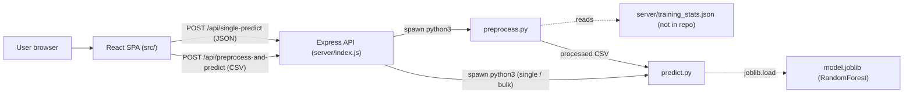

# HuntEX

> Exoplanet classification web app: a React interface over a Random Forest model trained on Kepler Objects of Interest (KOI) data.


## What it is and who it is for

HuntEX lets you submit Kepler KOI measurements, either one object by hand or a CSV file with many objects, and get a label for each one: `CONFIRMED`, `CANDIDATE` or `FALSE POSITIVE`. The predictions come from a scikit-learn `RandomForestClassifier` stored in `model.joblib`, served by a small Express API that runs a Python script for each request.

It is aimed at people who want to try the model from a browser, and at developers who want an example of wiring a React front end to a Python model through a Node API. `Improved-RF/README.md` describes it as built for the NASA Space Apps Challenge hackathon.

The results page shows the `CONFIRMED` and `CANDIDATE` objects revealed one at a time on an animated canvas. The positions on that canvas are chosen at random among free stars; they do not represent sky coordinates.

## Features

- **Landing page** with a canvas star-field background and an `UPLOAD DATA` button.
- **Upload modal** that lets you choose between bulk upload and single entry.
- **Single entry**: a form with the 11 model features (all required). It calls `POST /api/single-predict`.
- **Bulk upload**: drag-and-drop or file picker for `.csv` files, with a 100 MB limit checked in the browser and by the server (Multer).
- **Demo mode** in the bulk form: skips the backend and shows three hard-coded sample objects.
- **Hyperspace transition**: a 4-second canvas warp animation between the form and the results.
- **Results page**: reveals `CONFIRMED` and `CANDIDATE` objects one per second (`FALSE POSITIVE` objects are not shown). Clicking an object opens a side panel with its parameters.
- **CSV preprocessing** in `server/preprocess.py`, used by the bulk form: normalises column names, drops the leakage columns `koi_score` and `koi_pdisposition`, checks physical ranges, imputes missing optional values with training medians, applies log10 transforms and removes extreme outliers (5 × IQR). It depends on `server/training_stats.json`, which is not in the repository (see [Known limitations](#known-limitations)).

Errors from the API are only written to the browser console; the UI does not display them.

## Demo

Live deployment: https://huntex-app.vercel.app (the homepage set in the GitHub repository settings; it answered HTTP 200 when checked). The deployed build calls whatever API `VITE_API_BASE_URL` pointed to at build time, which this README cannot verify.

## Stack

**Frontend** (from `package.json`, version ranges as declared):
- React `^19.1.1` with TypeScript `~5.9.3`
- Vite `^7.1.7`
- Tailwind CSS `^4.1.14` through `@tailwindcss/vite`
- Framer Motion (`framer-motion` `^12.23.22`)
- Lucide React (`lucide-react` `^0.544.0`) for icons
- ESLint `^9.36.0` with the TypeScript and React Hooks plugins

**Backend**:
- Node.js with Express `^5.1.0` and Multer `^2.0.2` (`server/index.js`)
- Python 3 scripts (`server/predict.py`, `server/preprocess.py`) that use joblib, NumPy, pandas and scikit-learn. The versions pinned in `Improved-RF/requirements.txt` are `joblib==1.5.2`, `numpy==2.3.3`, `pandas==2.3.3` and `scikit-learn==1.7.2`.

**Model**: scikit-learn `RandomForestClassifier`, 200 trees and `max_depth=15` as stored in `model.joblib`, 11 input features and 3 classes.

## Requirements

- **Node.js and npm**. `package.json` does not declare an engine version. The build and lint were run with Node.js v24.22.1 and npm 11.21.1.
- **Python 3**, with the packages in `Improved-RF/requirements.txt`. Python 3.13.5 was used for verification.
- The API starts Python with the command `python3`, so that command must be on your `PATH`. The Express server does not check for it.

## Installation

```bash
git clone https://github.com/jnjambrin0/huntex-app
cd huntex-app

# Frontend and API dependencies (uses package-lock.json)
npm ci

# Python dependencies for the prediction scripts
python3 -m venv .venv
source .venv/bin/activate        # Windows: .venv\Scripts\activate
pip install -r Improved-RF/requirements.txt
```

## Usage

Start the API and the frontend in two terminals:

```bash
npm run server   # Express API on http://localhost:8000 (see PORT below)
npm run dev      # Vite dev server on http://localhost:5173
```

Then open http://localhost:5173, click **UPLOAD DATA** and choose:

- **Single entry**: fill in the fields below. Units are shown in the form labels.

  | Field | Description (form label) |
  |---|---|
  | `koi_period` | Orbital period (days) |
  | `koi_duration` | Transit duration (hours) |
  | `koi_impact` | Impact parameter |
  | `koi_prad` | Planet radius (Earth radii) |
  | `koi_teq` | Equilibrium temperature (K) |
  | `koi_insol` | Insolation flux |
  | `koi_steff` | Stellar effective temperature (K) |
  | `koi_slogg` | Stellar surface gravity |
  | `koi_srad` | Stellar radius (solar radii) |
  | `koi_depth` | Transit depth (ppm) |
  | `koi_model_snr` | Model signal-to-noise ratio |

- **Bulk upload**: choose a `.csv` file, or enable **Demo Mode** to see the results flow with sample data and no backend call.

A direct API call to the single-entry endpoint, with the values from the form's placeholders:

```bash
curl -X POST http://localhost:8000/api/single-predict \
  -H 'Content-Type: application/json' \
  -d '{"koi_period":2.47,"koi_depth":14284,"koi_duration":1.72,"koi_prad":14.4,"koi_teq":1394,"koi_insol":0.0,"koi_steff":5814,"koi_slogg":4.38,"koi_srad":1.06,"koi_model_snr":7856.1,"koi_impact":0.82}'
# {"label":"FALSE POSITIVE"}
```

Other API endpoints:

- `POST /api/bulk-upload` (multipart field `file`): runs the model directly on the CSV without preprocessing. The columns must already be in the model's units and transformed scale. `Improved-RF/examples/example_inputs.csv` has this format.
- `POST /api/preprocess-and-predict` (multipart field `file`): preprocesses a raw CSV, then predicts. This is the endpoint the bulk form uses. See [Known limitations](#known-limitations).

## Configuration

No `.env.example` file, no secrets and no service credentials are used by this repository. Both variables below are optional.

| Variable | Read by | Required | Description |
|---|---|---|---|
| `VITE_API_BASE_URL` | Frontend (`src/components/SingleEntryForm.tsx`, `src/components/BulkUploadForm.tsx`) | No; defaults to `http://localhost:8000` | Base URL of the API. Vite reads it at build or dev-server start, so restart after changing it. |
| `PORT` | Backend (`server/index.js`) | No; defaults to `8000` | Port the Express server listens on. |

## Architecture



Each form triggers the hyperspace transition as soon as it is submitted, without waiting for the API. `App.tsx` stores whatever results arrive and passes them to the results page, which reveals the detections over time.

### Known limitations

- **Bulk preprocessing does not run as committed.** `preprocess.py` loads `server/training_stats.json`, which is listed in `.gitignore` and is not in the repository. Its error message refers to `Improved-RF/extract_training_stats.py`, which is also not in the repository. Without the file, `POST /api/preprocess-and-predict` returns HTTP 500, so the bulk form cannot produce results from a real CSV. I confirmed this by calling the endpoint.
- **Single-entry validation errors return HTTP 500.** A request with a missing field returns `{"error":"Failed to process the request."}` with status 500, not 400. I confirmed this with a request missing 10 fields.
- **Model metrics are not documented here.** `Improved-RF/README.md` contains accuracy figures and links to `results/` and `GAN/` directories that are not in the repository, so this README does not repeat them.

## Project structure

```
huntex-app/
├── index.html
├── package.json              # scripts and dependencies
├── vite.config.ts            # Vite + React + Tailwind plugins, "@" alias
├── eslint.config.js
├── tsconfig*.json
├── src/                      # React frontend
│   ├── main.tsx
│   ├── App.tsx               # landing page and hyperspace flow
│   ├── index.css             # Tailwind and Google Fonts imports
│   ├── components/
│   │   ├── AnimatedBackground.tsx
│   │   ├── HyperspaceAnimation.tsx
│   │   ├── UploadModal.tsx
│   │   ├── BulkUploadForm.tsx
│   │   ├── SingleEntryForm.tsx
│   │   └── ResultsPage.tsx
│   └── types/exoplanet.ts
├── server/                   # Express API and Python prediction scripts
│   ├── index.js
│   ├── predict.py
│   └── preprocess.py
├── Improved-RF/              # ML training pipeline (Python)
│   ├── main.py, train.py, model.py, data.py, config.py, evaluate.py
│   ├── predict_example.py
│   ├── tools/                # dataset and prediction utilities
│   ├── examples/             # sample CSV inputs
│   ├── diagnostics/          # data quality report
│   ├── koi_merged.csv
│   └── koi_merged_pruned.csv
├── model.joblib              # trained model used by the API
├── public/                   # static assets (logo, favicon)
└── docs/                     # README screenshots
```

## Scripts and tests

Scripts from `package.json`:

| Command | What it does |
|---|---|
| `npm run dev` | Starts the Vite dev server (port 5173 by default) |
| `npm run build` | Runs `tsc -b` and then `vite build` into `dist/` |
| `npm run preview` | Serves the production build locally |
| `npm run lint` | Runs ESLint on the project |
| `npm run server` | Starts the Express API (`server/index.js`) |

**Tests: the repository has no automated test suite.** There are no test files and no test script. `npm run lint` and `npm run build` are the only automated checks. The Python code in `Improved-RF/` has no tests either. Training is run with `python Improved-RF/main.py`, as described in `Improved-RF/README.md`; I did not run training.

## License

This repository does not declare a license. There is no `LICENSE` file, and `package.json` has no `license` field.

## Author

Jaime Navas — [@jnjambrin0](https://github.com/jnjambrin0)
